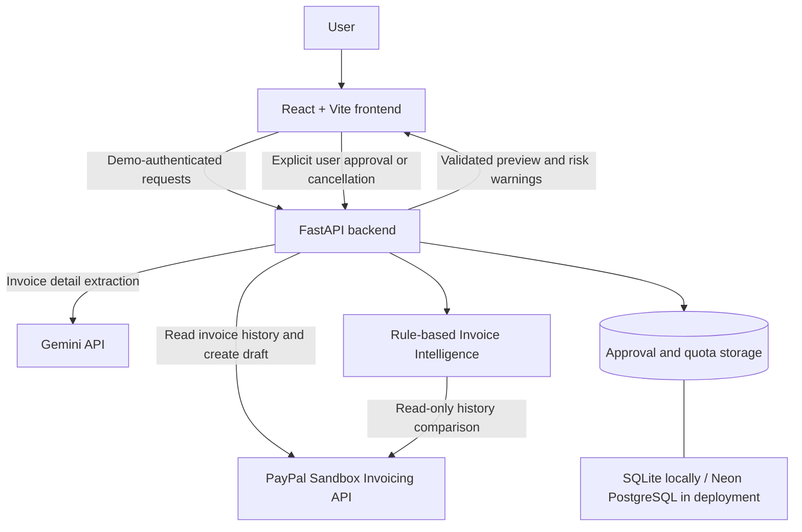

# PayPilot AI

**Conversational invoice drafting with human approval and PayPal Sandbox integration.**

PayPilot AI turns a natural-language request into a structured invoice preview, checks available PayPal Sandbox history for potential duplicate invoices or unusually large amounts, and asks a human to approve or cancel before creating a **draft**.

Built for the PayPal AI Hackathon 2026.

- **Live sandbox demo:** https://paypilot-ai-icx7.onrender.com
- **API:** https://paypilot-ai-api-lx1t.onrender.com/api/health
- **Repository:** https://github.com/senthurapandi2000/paypilot-ai

> **Sandbox only.** This project creates draft invoices in a PayPal Sandbox account. It does not send invoices to real customers or transfer real money. The public demo requires a passphrase; contact the maintainer for authorized access. Never include API keys or the demo passphrase in issues or screenshots.

## Why PayPilot AI?

Drafting invoices manually can mean copying customer details, checking amounts, and searching older invoices for possible duplicates. PayPilot AI brings those steps into one reviewable workflow:

1. Describe the invoice in natural language.
2. Gemini extracts the recipient, service, quantity, and unit price; missing or ambiguous fields are requested rather than invented.
3. FastAPI validates the extracted fields and creates a short-lived pending approval.
4. An **advisory**, rule-based Invoice Intelligence check examines available PayPal Sandbox invoice history.
5. Review the preview and warnings; **Approve & Create Draft** or **Cancel**.
6. If approved, PayPilot AI creates a PayPal Sandbox draft and shows the invoice in history.

A manual draft-creation form is also available.

## Features available in the deployed demo

- **Conversational preparation:** Gemini-powered extraction with server-side validation.
- **Human-in-the-loop approval:** a preview must be approved before the AI workflow creates a PayPal draft; pending approvals expire.
- **Cancellation:** discard an AI-generated preview without creating a draft.
- **Invoice Intelligence (advisory):** possible duplicates (same customer, normalized service, quantity and total within 30 days) and unusually large amounts (greater than 3x the median of at least five comparable invoices within 90 days).
- **Safe handling of incomplete history:** incomplete or unavailable history is reported instead of being treated as proof of no issues.
- **Reliability controls:** short-lived server-side approval records, atomic approval claims, idempotent invoice-creation requests, bounded retries for transient Gemini failures, and protection against repeated approvals.
- **Demo protection:** a demo passphrase, per-client request throttling, and optional shared PostgreSQL daily quotas.
- **Invoice history:** read previously created Sandbox invoices and refresh the dashboard.

**Invoice Intelligence is a rules engine, not a trained machine-learning fraud detector.** Its warnings do not establish fraud or authorization, and the user remains responsible for reviewing each invoice.

## Architecture



**Stack:** React 19, Vite, Python, FastAPI, Pydantic, HTTPX, Gemini, PayPal Sandbox REST APIs, SQLite, PostgreSQL (Neon), Render, pytest.

## Try the deployed demo

1. Open [PayPilot AI](https://paypilot-ai-icx7.onrender.com) and enter an authorized demo passphrase.
2. In the AI Assistant, try a **Sandbox** example such as:

   ```text
   Create an invoice for buyer@example.com for 2 hours of AI consulting at $25 per hour
   ```

   Replace `buyer@example.com` with a recipient from your own PayPal Sandbox test account as appropriate.
3. Click **Prepare Invoice with AI** and inspect the customer, service, quantity, unit price, total, and any history warnings.
4. Click **Cancel** to discard the preview without creating an invoice. For a draft-creation demonstration, use **Approve & Create Draft** only if you intend to create a Sandbox draft.
5. Check **Invoice History** to inspect drafts created in the Sandbox.

The demo uses shared request quotas, and the free hosting service may take time to respond after inactivity.

## Local setup

**Requirements:** Python, Node.js/npm, a Gemini API key, and PayPal **Sandbox** API credentials. Create a personal and business Sandbox account as required by PayPal's developer dashboard.

### Backend

From the repository root (PowerShell):

```powershell
cd backend
python -m venv .venv
.\.venv\Scripts\Activate.ps1
python -m pip install -r requirements.txt
Copy-Item .env.example .env
```

Edit `backend/.env` and supply your own values for `PAYPAL_CLIENT_ID`, `PAYPAL_CLIENT_SECRET`, `GEMINI_API_KEY`, and `PAYPILOT_DEMO_KEY`. Keep secrets out of Git.

For local development, use `APPROVAL_STORE_BACKEND=sqlite`. Set `ENABLE_INVOICE_INTELLIGENCE=1` if you want PayPal Sandbox history-based warnings; otherwise it is disabled by default. The local development server can be started with:

```powershell
python -m uvicorn main:app --reload --host 127.0.0.1 --port 8000
```

The health endpoint is `http://127.0.0.1:8000/api/health`.

### Frontend

Open a second PowerShell terminal from the repository root:

```powershell
cd frontend
npm install
Copy-Item .env.example .env
npm run dev
```

The example frontend environment points to `http://127.0.0.1:8000`. Open the local Vite URL printed in the terminal. Enter the same demo passphrase configured for the backend.

### Deployment configuration

The deployed demo uses Render for the frontend/backend and Neon PostgreSQL for shared approval and quota persistence. Relevant backend configuration includes:

| Variable | Purpose |
|---|---|
| `PAYPAL_CLIENT_ID`, `PAYPAL_CLIENT_SECRET` | PayPal Sandbox authentication |
| `GEMINI_API_KEY`, `GEMINI_MODEL` | Gemini generation configuration |
| `PAYPILOT_DEMO_KEY` | Private demo passphrase |
| `FRONTEND_ORIGIN` | Allowed deployed frontend origin |
| `APPROVAL_STORE_BACKEND` | `sqlite` locally or `postgres` in cloud |
| `DATABASE_URL` | PostgreSQL connection URL when using cloud persistence/quotas |
| `ENABLE_DAILY_QUOTAS` | Enable shared daily PostgreSQL request quotas |
| `ENABLE_INVOICE_INTELLIGENCE` | Enable advisory history review |

Do not commit `.env`, production credentials, or connection strings. When deploying, set the frontend's `VITE_API_BASE_URL` to the deployed API origin before building.

## Tests and evaluation

Run backend tests:

```powershell
cd backend
.\.venv\Scripts\python.exe -m pytest -q tests
```

Run frontend checks:

```powershell
cd frontend
npm run lint
npm run build
```

Reproduce the two rule-based risk benchmarks from the backend directory:

```powershell
$env:PYTHONPATH = (Get-Location).Path
.\.venv\Scripts\python.exe evaluation\evaluate_review.py
.\.venv\Scripts\python.exe evaluation\evaluate_challenge.py
```

| Evaluation | Cases | Accuracy | F1-score | Interpretation |
|---|---:|---:|---:|---|
| Rule-aligned synthetic cases | 1,000 | 100% | 100% | Regression consistency on examples constructed around the existing rules |
| Hand-designed challenge cases | 16 | 75% | 71.43% | Reveals errors with recurring billing and anomalous amounts |

These results are **not** estimates of real-world fraud-detection performance. The project does not train a model for risk detection. Benchmark labels are synthetic; the challenge benchmark is small and includes contextual assumptions unavailable to the current live rule engine. Additional independent validation is needed.

## Experimental work (not part of the deployed demo)

[Draft PR #1 — Context-aware invoice review and fingerprint-bound evidence](https://github.com/senthurapandi2000/paypilot-ai/pull/1) explores billing-period comparisons, amount-baseline evidence, local operator attestations, SQLite evidence storage, and invoice content fingerprints. The feature has local tests but **is not production-ready**: it requires a stronger reviewer-identity model, authoritative invoice provenance, and a reviewed deployment/storage design. Do not describe this branch as live functionality.

## Safety and limitations

- Sandbox draft creation only; no automatic invoice sending or live payments.
- AI extraction is checked by Pydantic and must be reviewed by a human.
- Risk alerts are advisory; a missing alert does not prove an invoice is safe.
- History inspection is limited by API access, normalization coverage, and a bounded number of retrieved invoices.
- No claim is made that invoices are fraud-free or legally compliant.
- The shared demo passphrase is an access control for demonstration, not enterprise user authentication.

## Project status

The core React/FastAPI/Gemini/PayPal Sandbox workflow is deployed and has been exercised with invoice preparation, duplicate-warning display, and safe cancellation. The project remains an actively developed **hackathon prototype**.
